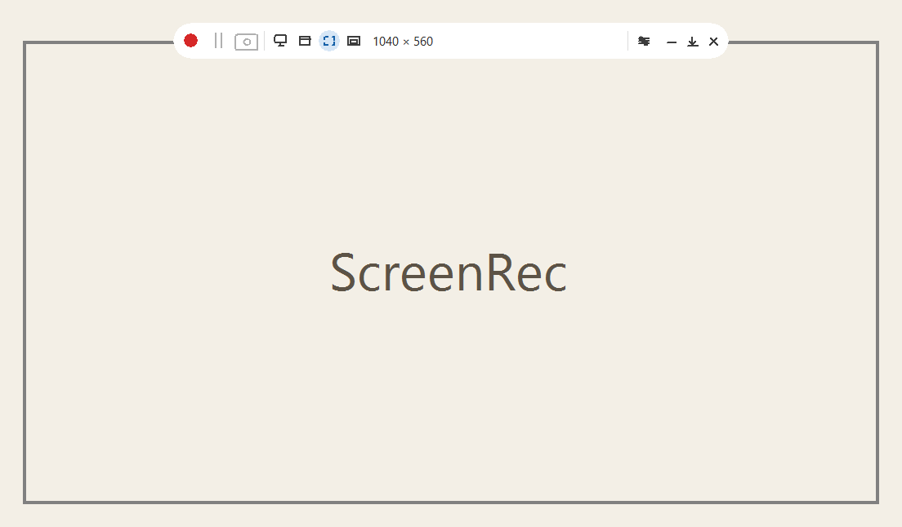
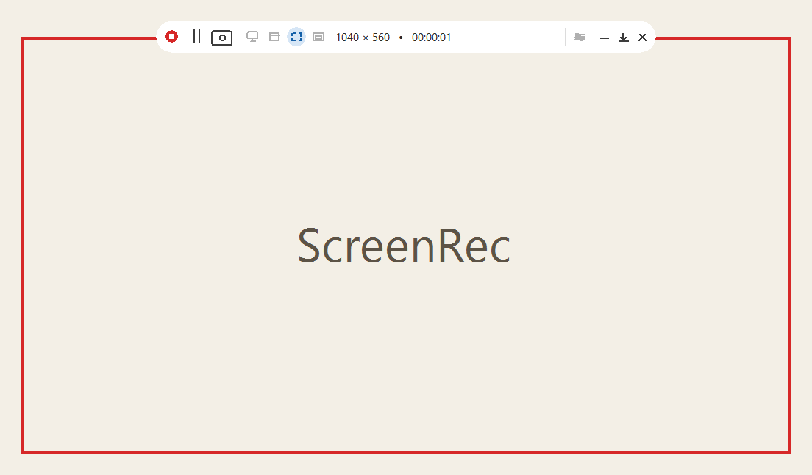
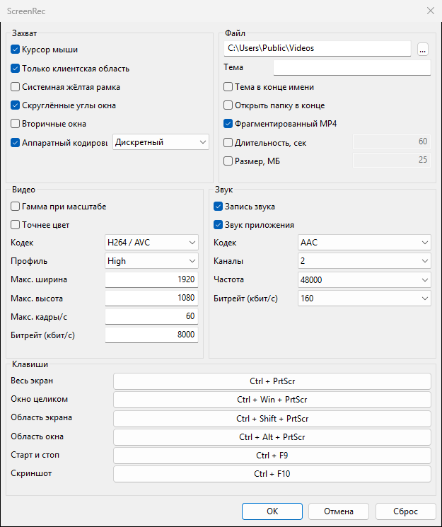

# ScreenRec 1.0

Локальная запись экрана для Windows. Программа стоит на компьютере, пишет ролик в выбранную папку и никуда его не отправляет.

Четыре способа захватить картинку:

- весь экран монитора;
- окно целиком;
- произвольная область экрана;
- произвольная область внутри выбранного окна.

Окно и область окна снимаются через Windows Graphics Capture: если поверх цели оказывается другое окно, в ролик оно не попадает.

## Как выглядит

Рамка и панель до начала записи. Выбрана область экрана.



Во время записи рамка красная, на панели идёт время ролика.



Окно настроек. Папка в примере — общая папка «Видео».



## Захват

Область экрана и область окна обозначаются протяжкой мыши с зажатой левой кнопкой. Короткий щелчок и протяжка меньше 8 пикселей область не задают. Правая кнопка или Esc отменяют обозначение. Экран при этом не затемняется.

Окно целиком выбирается щелчком по окну. Весь экран берёт монитор, на котором стоит рамка.

На панели: запись, пауза, скриншот, четыре режима, настройки, свернуть, свернуть в трей, закрыть. Рамка и панель в запись не попадают.

## Во время записи

Пауза не режет файл: время паузы вычитается из меток, ролик остаётся одним.

Скриншот можно сделать только пока идёт запись. Картинка PNG сохраняется рядом с видео, запись не останавливается. На короткое время рамка вспыхивает жёлтым.

Пока запись идёт, режим захвата не переключается. Область экрана и область окна можно передвинуть.

## Звук и картинка

По умолчанию пишется звук системы. В режимах окна дополнительно можно писать звук выбранного приложения. С микрофона программа звук не снимает.

Кодеки: H.264, HEVC и AV1. Звук — AAC. По умолчанию фрагментированный MP4, аппаратный кодировщик, до 1920×1080 и 60 кадров/с. Имя файла — дата и время, к нему можно добавить тему.

Жёлтая системная рамка Windows в настройках выключена. На части сборок Windows 11 она всё равно появляется у программы без подписи пакета.

## Горячие клавиши

| Действие | Клавиши |
| --- | --- |
| Весь экран | Ctrl + PrtScr |
| Окно целиком | Ctrl + Win + PrtScr |
| Область экрана | Ctrl + Shift + PrtScr |
| Область окна | Ctrl + Alt + PrtScr |
| Старт и стоп | Ctrl + F9 |
| Скриншот | Ctrl + F10 |

Сочетания меняются в настройках.

## Установка

Нужны 64-битная Windows 10 версии 2004 (сборка 19041) или новее, либо Windows 11.

Установщик: [ScreenRec-1.0.0-x64-setup.exe](https://github.com/neuromafka-create/ScreenRec/releases/download/v1.0.0/ScreenRec-1.0.0-x64-setup.exe).

Он ставит программу в профиль пользователя и не просит права администратора. В меню «Пуск» появляется ярлык, в «Приложениях и возможностях» — запись ScreenRec. Значок на рабочем столе и запуск при входе в Windows — отдельные пункты, по умолчанию выключены. Удаление стирает программу и её настройки рядом с ней. Готовые ролики в папке видео остаются.

Портативный режим: скопируйте `ScreenRec-x64.exe` в свою папку и запустите. Рядом появится `ScreenRec-x64.ini`. Этот файл в репозиторий не входит.

Установщик собран только для x64. Версию для ARM64 можно собрать `build.cmd` на ARM64-машине, в поставку 1.0 она не входит.

## Сборка

Нужны Visual Studio 2022 Build Tools с компонентом C++ и Windows SDK, для установщика — [Inno Setup 6](https://jrsoftware.org/isdl.php).

```bat
build.cmd
build-installer.cmd
```

Первая команда даёт `ScreenRec-x64.exe`. Вторая — `dist\ScreenRec-1.0.0-x64-setup.exe`.

## Лицензия

Код программы — [Unlicense](LICENSE), общественное достояние. Захват и кодирование основаны на [wcap](https://github.com/mmozeiko/wcap) Мартина Можейко.
